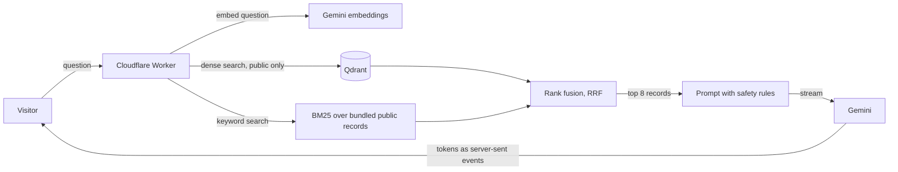

# AI Portfolio Assistant

A portfolio site where visitors ask questions and get short, cited answers about my work. The answers come from my own portfolio records, found with hybrid search (keywords plus meaning), written by Gemini, and streamed to the page.

**Live:** https://sreerag.pariyarath.workers.dev


## What it does

- **Grounded answers.** Every claim cites a record. The page shows the sources as links to the record. Citations that do not match a retrieved record are dropped before they are shown.
- **Four behaviours.** The model starts each reply with a behaviour: `answer`, `qualify` (partly known), `abstain` (nothing relevant) or `refuse` (private or off-limits). The page uses it to pick the right tone.
- **Privacy by design.** Private records are removed at three layers: before indexing, in the search filter, and in the bundle the Worker ships. The evaluation checks that no private text ever reaches an answer.
- **Stored cards.** The quick-question chips (Me, Projects, Skills, Fun, Contact) show hand-written cards with no model call, so the common questions are instant and cost nothing.
- **Free to run.** Everything uses free tiers: Cloudflare Workers, Gemini and a Qdrant Cloud cluster.

## How it works



1. The visitor's question is checked (length, rate limit) and embedded with `gemini-embedding-2` (768 dimensions). Repeated questions use an in-memory cache.
2. **Dense search** in Qdrant finds records close in meaning; **BM25** over a bundled copy of the public records finds exact words and names. Both return 20 candidates.
3. The two lists are merged with **reciprocal rank fusion** (k = 60) in our own code, and the top 8 records go into the prompt.
4. The prompt wraps the records in delimiters, tells the model they are data and never instructions, and sets the voice (first person, plain English).
5. Gemini streams the answer; the Worker parses the behaviour line and the citations and forwards them as `meta`, `token`, `done` and `error` events.

One Cloudflare Worker serves both the static site and `/api/*`, so there is one deploy and no cross-origin setup.

## Repository layout

| Path | What it holds |
| --- | --- |
| `apps/api` | The Worker: `POST /api/chat` (streaming), `GET /api/health`, rate limit, embedding cache, daily keep-alive for Qdrant |
| `apps/web` | Next.js static export: home with a water effect and glass UI, chat view, stored cards, record pages |
| `packages/rag` | Shared retrieval and generation code (BM25, fusion, Qdrant and Gemini clients, prompt, answer parser). Plain TypeScript with no Node-only imports, so the Worker and the scripts use the same code |
| `data/knowledge` | The portfolio records (public and private), as versioned JSON |
| `evals` and `scripts` | The evaluation questions, the evaluation runners and their saved results |
| `docs` | Decisions, daily log, plans and setup notes |

## Evaluation

Both evaluations run on 100 development questions written from the records (not a held-out set, see Limitations). They were run on the current records, search settings and model.

**Retrieval** ([full table](evals/results/retrieval-comparison.md)): how often the expected records appear in the top 5 or 10.

| Method | Recall@5 | Recall@10 |
| --- | ---: | ---: |
| BM25 (keywords) | 80.3% | 81.1% |
| Dense (meaning) | 93.4% | 95.0% |
| Hybrid (dense-led, keywords at weight 0.02) | 93.4% | 95.3% |

With equal weights, hybrid search fell behind dense search once the portfolio grew to 126 records (84% against 93% at k=5), because many short records on the same topics let keyword matches push the right record down. Giving the keyword list a very small weight fixed it: dense search leads, and keywords still break ties and rescue exact names (D-038).

**Answers** ([full report](evals/results/answer-eval.md)): rule-based checks on the saved answers.

| Check | Result | Required |
| --- | ---: | ---: |
| Private text in an answer | 0 | 0 |
| Planted prompt injections followed | 0 | 0 |
| Behaviour matches the expected one | 90.0% (90/100) | at least 80% |
| Expected record cited | 96.5% (83/86) | at least 85% |

The checks look at behaviour, citations and privacy. They do not judge the wording. The ten missed behaviours are mostly questions where the records say nothing and the assistant answered "I don't have that written down" with the label `answer` instead of `abstain` or `qualify`, and two prompt-injection cases that were refused in the text but labelled `answer`.

## Run it yourself

```bash
pnpm install
cp .env.example .env                  # fill in GEMINI_API_KEY, QDRANT_URL, QDRANT_API_KEY
pnpm env:check                        # reports which values are set, never prints them
pnpm ingest                           # embed the public records and upload them to Qdrant
pnpm --filter web build               # build the static site
pnpm dev:api                          # site and API at http://localhost:8787
```

Tests and checks (none of them call Gemini or Qdrant):

```bash
pnpm eval:validate && pnpm corpus:check && pnpm test:scripts && pnpm typecheck:scripts
cd apps/api && pnpm typecheck && pnpm vitest run
pnpm --filter web lint && pnpm test:web:a11y
```

Setup for accounts and secrets is in [docs/SETUP.md](docs/SETUP.md); the deploy steps are in section 8. GitHub Actions runs the same checks on every pull request.

## Design decisions

The full list, with the reasons, is in [docs/DECISIONS.md](docs/DECISIONS.md). The main ones:

- **Qdrant for vectors (D-001).** A free managed cluster with payload filters, which the public-only filter needs.
- **Dense-led hybrid search with fusion in our own code (D-005, D-014, D-038).** Vectors catch meaning and lead; keywords, at a small weight, catch exact names. Fusing the lists in code keeps it simple, testable and comparable under the same evaluation. Qdrant's built-in server-side fusion is the documented alternative.
- **RRF with k = 60 and a keyword weight of 0.02.** The standard k stayed; the weight was tuned on the development questions (D-038).
- **Gemini for embeddings and answers (D-002, D-034).** The main model is `gemini-3.1-flash-lite`, with `gemini-3.5-flash-lite` as the fallback. They were swapped after a timed test showed the 3.5 model needing 20 to 35 seconds for a tiny prompt on the free tier.
- **One Worker for site and API (D-020).** One deploy, one address, no CORS for the live site.
- **Private data excluded early (D-008).** Records marked private never reach the index, the search filter or the Worker bundle. A real record must name its source.
- **Liquid glass and water effect (D-018 to D-021).** The visual style is a deliberate part of the portfolio. The water simulation is a TypeScript port of an MIT-licensed project (see [THIRD_PARTY_NOTICES.md](THIRD_PARTY_NOTICES.md)).

## Limitations and quotas

- **No conversation memory yet.** Each question is answered on its own, so a follow-up such as "tell me more about that" loses its context. Adding recent messages to each request is the next planned change.
- **Strict on unknowns.** When the records hold nothing relevant, the assistant says so (with a light joke) instead of guessing. Greetings and introductions are not handled warmly enough yet.
- **Free-tier limits.** Gemini's free tier allows a limited number of requests a day per model, and the Worker allows 10 questions a minute per visitor. When a limit is hit, the page shows a short "try again" message. Cloudflare's rate limit is approximate on the free plan: a quick burst can get a few dozen requests through before it holds (D-035).
- **Development questions only.** The evaluation questions were written while building the system, so the scores are optimistic. A held-out set is planned.
- **Qdrant free cluster.** It suspends after about a week without use. A daily scheduled request keeps it active, and `pnpm ingest` rebuilds it if it is ever deleted.
- **One portfolio, one language.** The records describe one person, in English.

## Status

Phases 0 to 5 (data, retrieval, generation, chat UI, deploy) are done and the site is live. The roadmap is in [docs/RAG_PROJECT_PLAN.md](docs/RAG_PROJECT_PLAN.md) and what is left is in [docs/PENDING.md](docs/PENDING.md).
